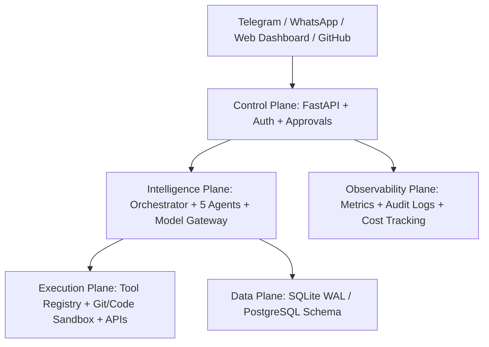

# Architecture — AutoAgentHub Personal Intelligence & Execution OS

## System Planes

1. **Control Plane (`server.py`, `os_routes.py`, `security.py`)**: FastAPI gateway, Bearer/allowlist auth, parameter-bound approval gates, Telegram/WhatsApp/GitHub webhook ingress.
2. **Intelligence Plane (`orchestrator.py`, `model_gateway.py`, `agents/*`)**: Concurrent worker pool, deterministic-first routing, Career/Tech/Finance/Geopolitics/Profile agents, and Daily Briefing synthesizer.
3. **Execution Plane (`tool_registry.py`, `agent_runner.py`, `github_tools.py`)**: Least-privilege tool authorization, isolated repo workspaces with path-traversal protection, and `auto` (`agy` / Gemini) runner.
4. **Data Plane (`db.py`, `task_store.py`)**: Normalized relational schema (profiles, projects, experiments, memories, jobs, evaluations, tech_items, watchlists, market_observations, geopolitical_events, approvals, audit_logs, model_usage, events, tasks, dead_letter_queue).
5. **Communication Plane (`server.py`, `messaging_tools.py`, `static/index.html`)**: Telegram interactive menus/buttons, WhatsApp Cloud API, and responsive Web Command Centre at `/dashboard`.
6. **Observability Plane (`/metrics`, `/health`, `audit_logs`, `model_usage`)**: Queue depth, worker utilization, circuit breaker states, token/cost logs, and secret-redacted audit trail.

## ADR-001: ORQEN Cancellation & Decoupled Orchestration
- **Decision:** Cancelled ORQEN integration per user instruction and built on `ConcurrentOrchestrator` + `DurableTaskStore` + `ToolRegistry`.
- **Rationale:** Keeps agents decoupled from the task queue so any external runtime can be swapped in without modifying agent modules.
